# da-learn-23 · 120 years of Olympic history (1896-2016)

A data-analyst learning project on the classic Kaggle **Olympic athletes and results** dataset: every athlete entry at the modern Olympic Games from
Athens 1896 to Rio 2016, **271,116 raw rows covering 135,571 athletes, 51 Games editions and 230 national
Olympic committees**. The project asks who wins medals and how that changed through the Cold War and after, whether hosts really win more at home,
how fast women reached parity, which nations turn athletes into medals most efficiently, and what body type and age each sport rewards.
The pipeline runs through SQL staging, cleaning (de-duplication, `NA` handling, types, NOC-to-region mapping with fixes, team-name normalisation,
outlier flags, scoping out the 1906 Intercalated Games and Art Competitions, and collapsing team members into one medal per podium place), a star
schema, KPI analysis and quality checks. DuckDB runs the whole pipeline locally on the **full** data in about 2 seconds. The outputs are a
Power BI kit plus SVG and PNG charts in `results/images/`.

> **Databricks was skipped** for this project because the Databricks workspace hit its resource quota. There is no live Lakeview dashboard. The SQL
> stays Databricks/Spark-compatible (the DuckDB shims are isolated in `sql/00`), and all charts and KPIs are in [`results/`](results/RESULTS.md).

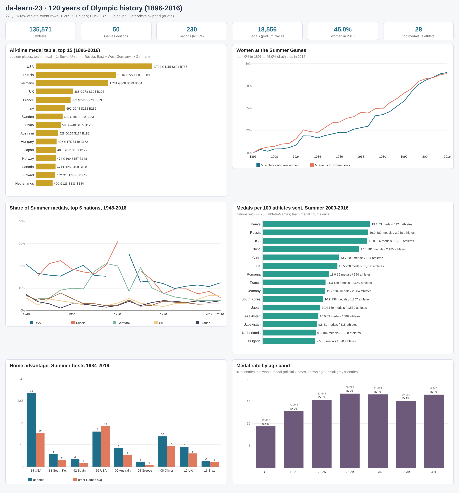

## Business questions
1. Which nations have won the most Olympic medals, and how did the balance of power shift between eras (pre-war, Cold War, post-1992)?
2. Is there a home advantage, and how large is it?
3. How did participation grow, and how quickly did women approach parity in athletes and events?
4. Which nations win the most medals per athlete they send?
5. What body type (height, weight, BMI) and age does each sport reward, and at what age are medals most likely?
6. Which nations dominate individual sports, and who are the most decorated Olympians?
7. How clean is the raw scrape (duplicates, missing values, code mismatches, team medals repeated per athlete), and what had to be fixed?

## Pipeline
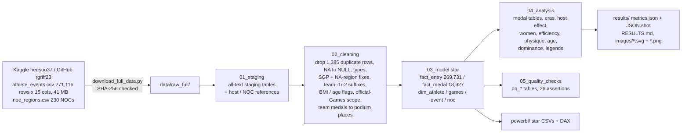

## Headline insights (full data, 1896-2016)
1. **The USA tops the all-time table, but the Soviet Union ruled the Cold War.** Counting each podium place once (a relay gold is one medal, not four), the USA has won 2,792 medals (15.1% of all, 1,115 gold), Russia including the Soviet Union and Unified Team 1,916, and Germany (East + West + unified) 1,731. In 1948-1988 the Russia/Soviet region took 16.7% of medals vs 14.6% for the USA; since 1992 the USA leads again (11.2%) and China has climbed to 4th (6.7%).
2. **Women went from absent to near parity.** No women competed in 1896; they were 9.7% of Summer athletes in 1948 and 45.0% in Rio 2016, when 44.4% of events were women-only. The Games also grew from 176 athletes from 12 nations to 11,179 from 207.
3. **Home advantage is real.** Since 1948 the host won a bigger share of medals at home than its own average at the other same-season Games within 12 years in 32 of 36 Games (median lift 1.61x). The USA took 25.3% of medals in Los Angeles 1984 (Soviet-led boycott) and the Soviet Union 30.9% in Moscow 1980 (US-led boycott); China rose from 7.14% to 10.38% in Beijing 2008. Atlanta 1996 is a rare exception for the USA (12.01% vs 13.9%).
4. **Small teams can be the most efficient.** In the Summer Games of 2000-2016, Kenya won 19.3 medals per 100 athletes sent (53 from 274), ahead of Russia (19.0), USA (18.8) and China (17.4).
5. **Every sport has a body type and an age.** In 1992-2016 male basketball players averaged 199.9 cm and 99.0 kg, female gymnasts 153.9 cm and 45.6 kg, and male weightlifters only 170 cm but 85 kg (BMI 29.0). Medallists are youngest in rhythmic gymnastics (median 18.5) and oldest in equestrianism (median 36). Across all Games, under-18 entries win a medal 9.4% of the time vs 16.7% at 26-29.
6. **Dominance and legends.** China won 77% of all diving golds since 1992 (37 of 48) and the USA 40% of swimming golds. Michael Phelps has 28 medals (23 gold), 10 more than the next athlete, gymnast Larysa Semenivna Latynina (18).

Full tables, all insights and the data-quality evidence are in [`results/RESULTS.md`](results/RESULTS.md).

## Charts
All charts are in `results/images/` as SVG (plain vector shapes, no embedded raster) and PNG (2x headless-Chrome render of the same SVG).

| | |
|---|---|
| 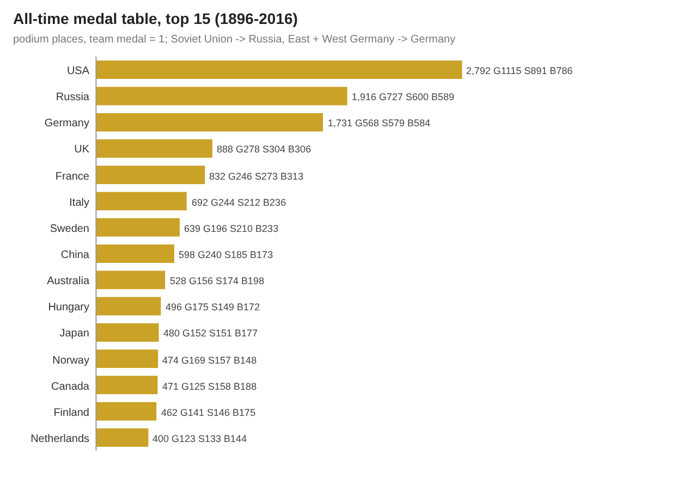 | 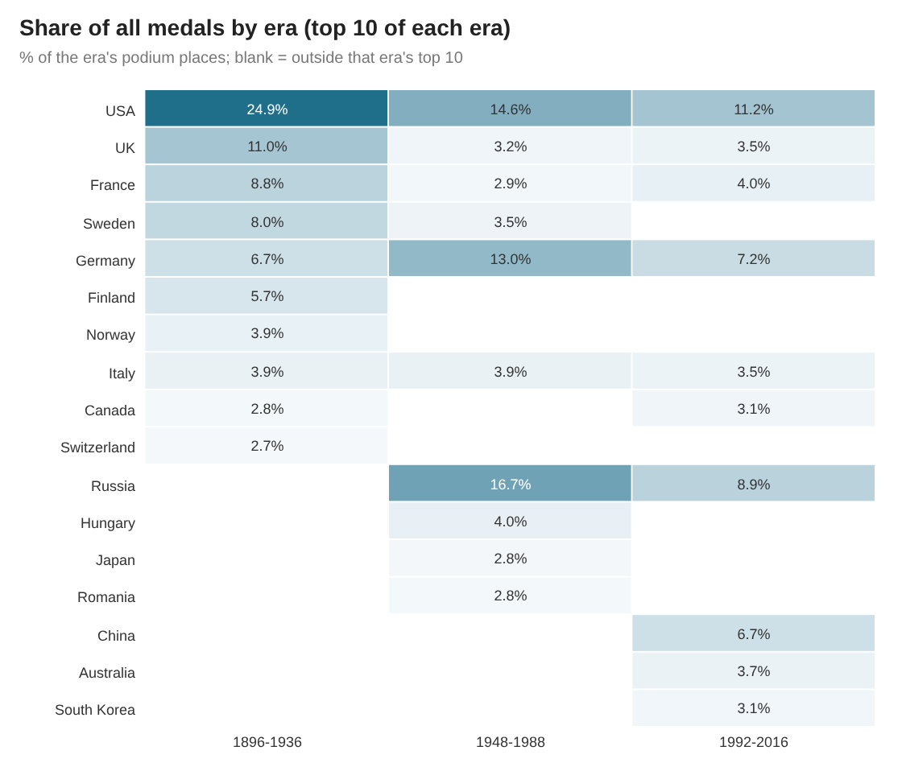 |
| 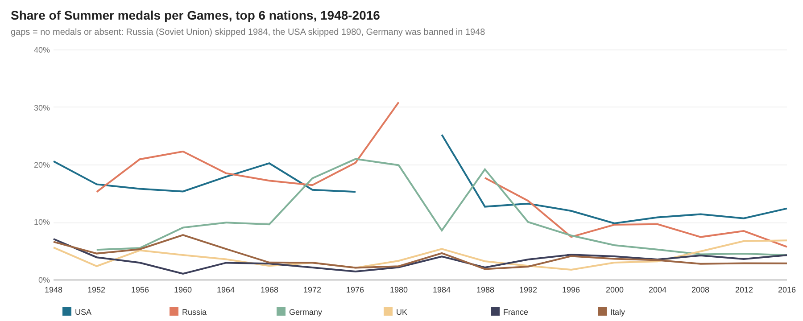 | 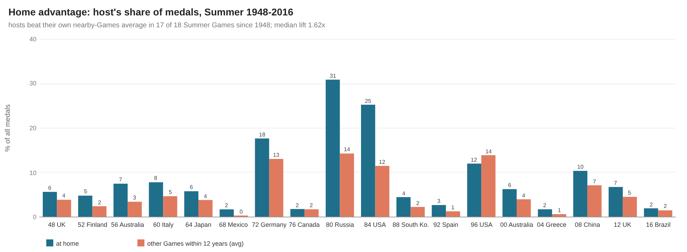 |
| 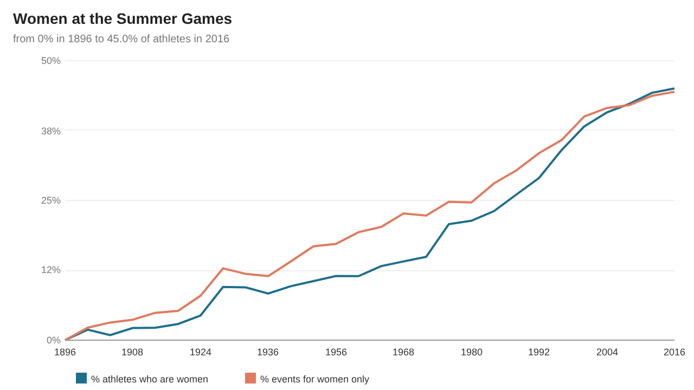 | 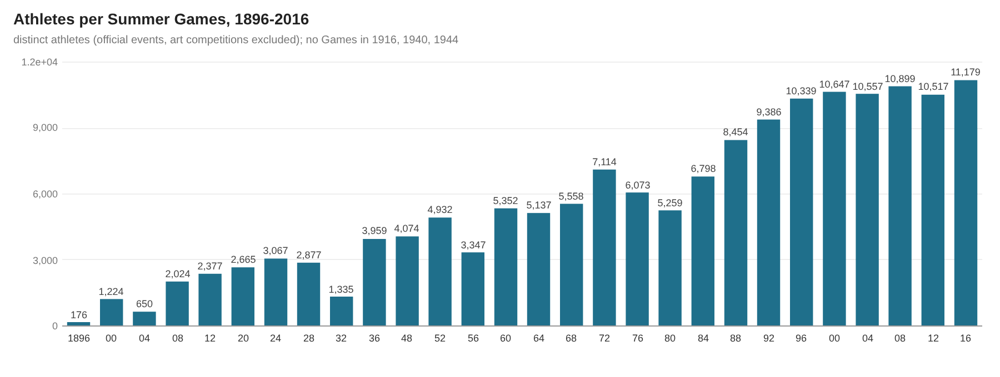 |
| 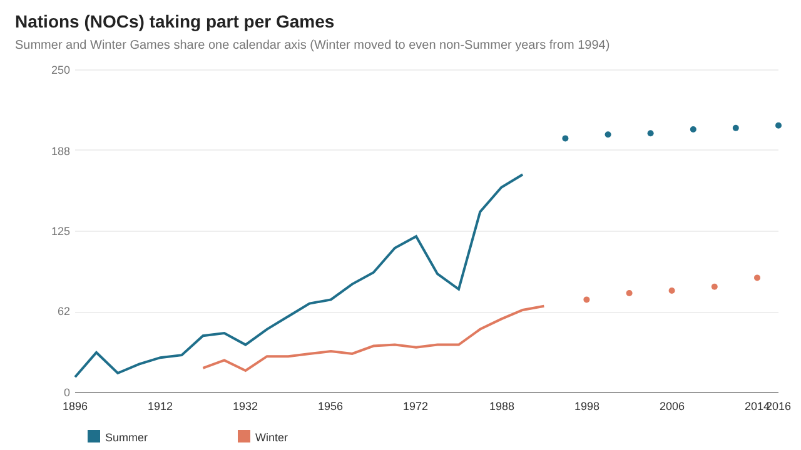 | 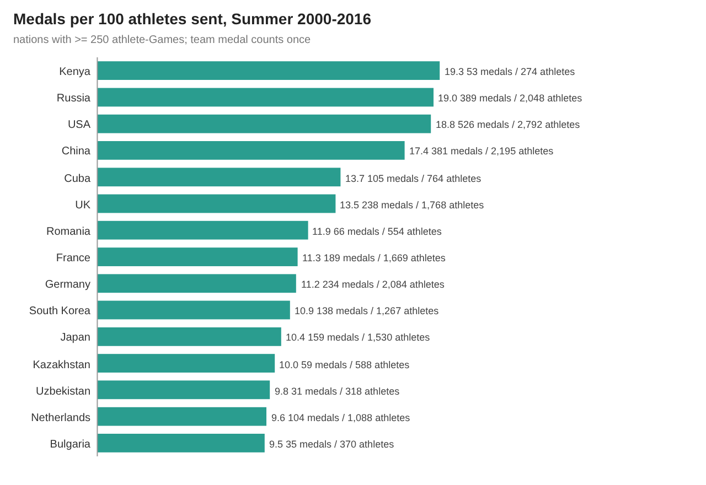 |
| 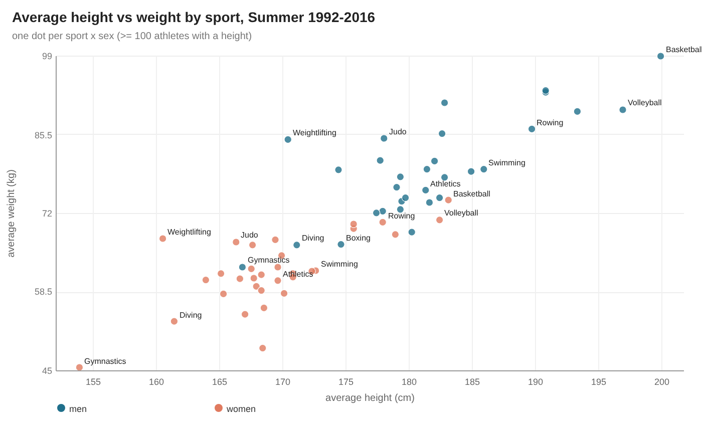 | 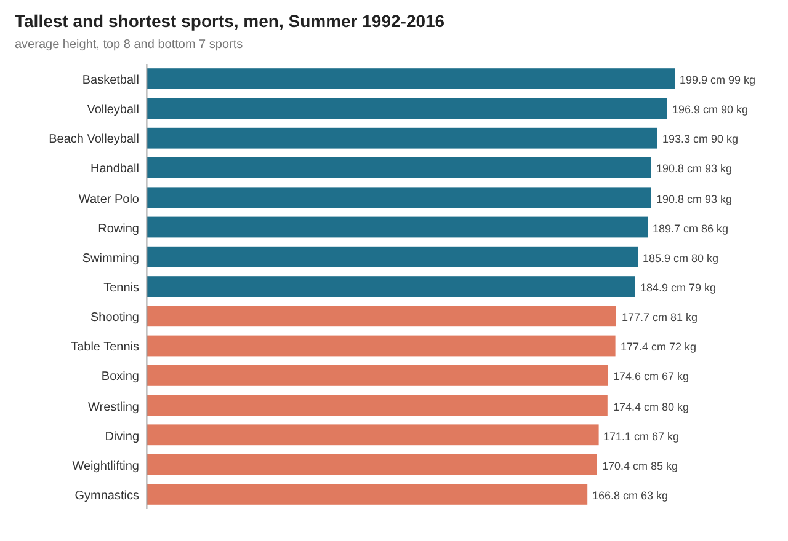 |
| 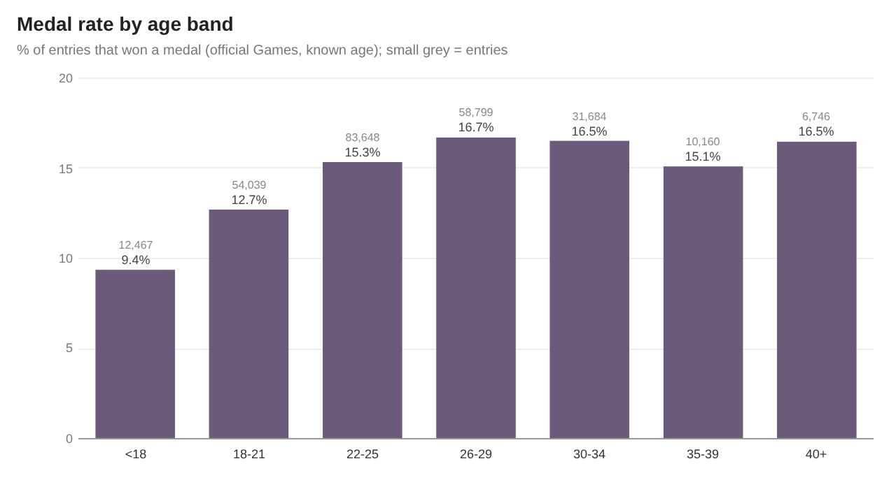 | 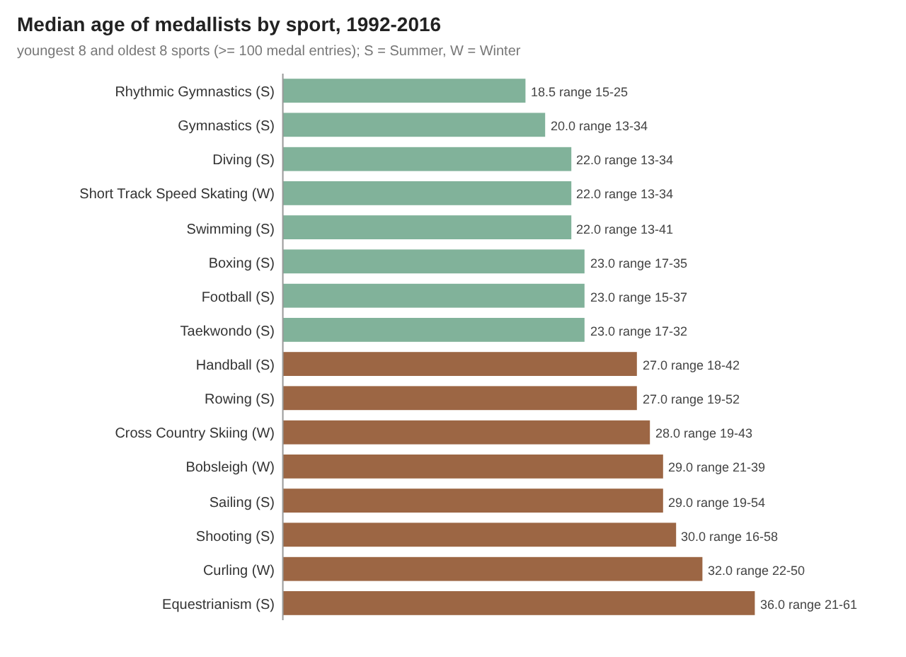 |
| 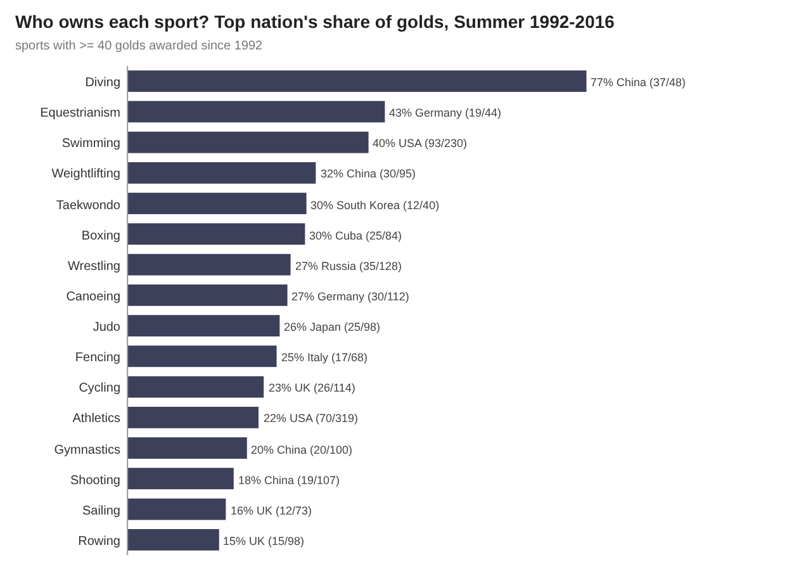 | 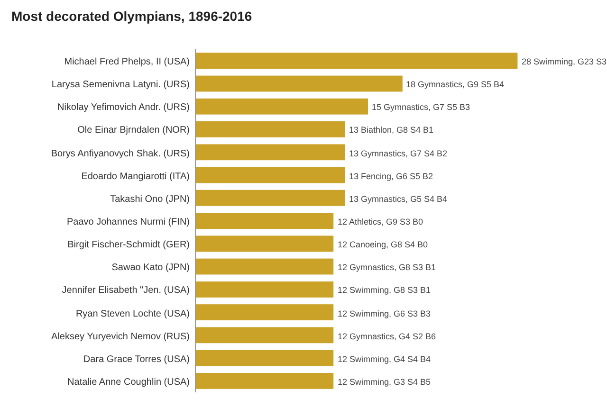 |
| 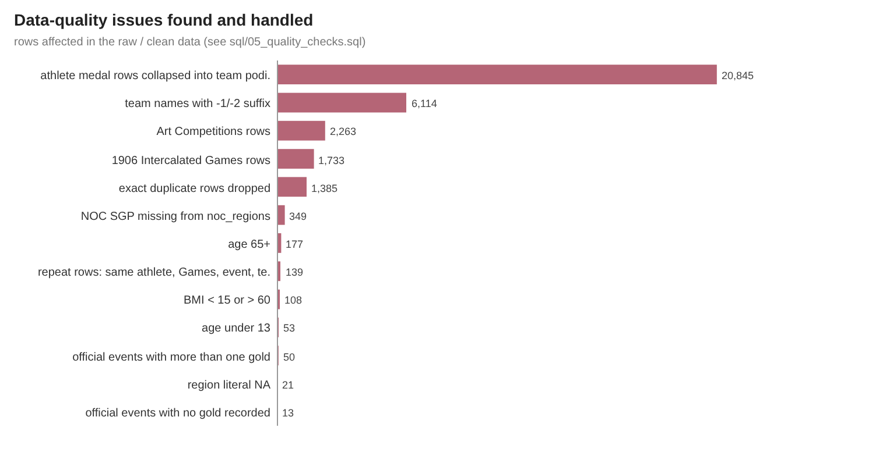 |  |

**How the images were made:** `scripts/make_charts.py` reads the DuckDB query results exported to `results/tables/*.csv` and writes each chart as a
plain-vector SVG with the small custom writer `scripts/svgcharts.py` (rect/line/polyline/circle/text only, no plotting library).
`scripts/render_png.py` then rasterises every SVG to PNG at 2x with headless Google Chrome.

## How to run
```bash
pip install -r requirements.txt
python run_pipeline.py --source sample       # committed raw sample in data/raw/ (15,313 rows, 2.4 MB) -> results/sample/
python scripts/download_full_data.py         # 41 MB -> data/raw_full/ (GitHub mirror of the Kaggle files, SHA-256 checked)
python run_pipeline.py --source full         # full data (~2 s of SQL): results/, data/clean/, powerbi/data/, RESULTS.md
python scripts/render_png.py                 # results/images/*.svg -> *.png with headless Chrome
```
`scripts/make_sample.py` rebuilds the committed sample from the full files. The runner stops with an error if any assertion fails (26/26 pass on
both the full data and the sample).

## Method notes
- **Grain.** One raw row is one athlete in one event at one Games. Team events repeat the medal on every team member's row, so medal counts use
  `fact_medal`: one row per Games x event x NOC x team entry x medal. A gold in the men's eight is 1 medal, not 9. This gives 18,556 official podium
  places from 39,158 athlete medal rows. Caveat: two athletes of the same nation sharing the same medal in an individual event (rare ties) collapse
  into one.
- **Official scope.** The 1906 Intercalated Games (1,733 rows) are not recognised by the IOC and the 1912-1948 Art Competitions (2,263 rows) are not
  sport, so both are kept in the clean data but excluded from the analysis (`is_official = 0`).
- **Nations.** NOCs map to modern regions with `noc_regions.csv`: the Soviet Union and the 1992 Unified Team count as Russia, East and West Germany
  as Germany, Yugoslavia as Serbia, and so on. The NOC-level medal table (`a_medal_table_noc`) keeps historic teams separate. `SGP` (Singapore,
  349 rows) is missing from the lookup (listed as `SIN`) and is added in `data/reference/noc_region_overrides.csv`; ROT, TUV and UNK have the
  literal region `NA` and use their notes instead.
- **Duplicates and repeats.** 1,385 rows are exact copies and are dropped. 139 rows remain where the same athlete appears twice in the same Games,
  event and team: separate races in 1900 and 1908 (sailing, rowing) and several submitted works in the art competitions. They are real and kept.
- **Teams.** Second and third crews have suffixed team names (`United States-1`, `Germany-2`, 6,114 rows); the suffix is stripped for the clean
  `team` column but kept for medal de-duplication so two crews from one nation stay separate.
- **Home advantage.** The host's share of all medals at its Games vs its average share at the other same-season Games within 12 years (3 to 5
  editions). Host nation is the main host city's NOC from `data/reference/host_nations.csv`, mapped to region (so West Germany hosting Munich 1972 is
  compared with Germany's share).
- **Body type and age.** Height and weight are missing for 22-23% of rows overall and 79% before 1960, so physique views use Summer 1992-2016 (5.4%
  missing), one row per athlete x Games x sport. 108 rows with BMI below 15 or above 60 are flagged and left out of the BMI average. Ages of 65+
  (177 rows, mostly art and equestrian) and under 13 (53) are real and kept.
- **Efficiency.** Medals per 100 athlete-Games in the Summer Games 2000-2016, nations with at least 250 athlete-Games. Because a team medal counts
  once, nations strong in team sports look less efficient than nations strong in individual events.

## Repo layout
```
data/raw/            deterministic sample of the raw files (15,313 of 271,116 rows + noc_regions.csv); full files via scripts/download_full_data.py
data/reference/      host nation per Games, NOC region overrides
data/clean/star/     star schema from the full run (dims + fact_medal complete, fact_entry 1-in-5 sample)
sql/                 00 DuckDB shims, 01 staging, 02 cleaning, 03 star model, 04 analysis, 05 quality checks
run_pipeline.py      runs sql/00-05 on DuckDB and writes all outputs (--source sample | full)
scripts/             download, sample builder, chart writer (svgcharts.py, make_charts.py), PNG renderer, RESULTS.md writer, project settings
powerbi/             star CSVs, measures.dax, model.md, dashboard_spec.md, BUILD_GUIDE.md (no .pbix: needs Windows)
results/             RESULTS.md, metrics.json, JSON.shot, tables/*.csv, images/*.svg + *.png, sample/ (same pipeline on the sample)
```

## Complete dataset
This repo only holds a deterministic sample of the raw data. The complete dataset is:

- **Kaggle page:** [120 years of Olympic history: athletes and results](https://www.kaggle.com/datasets/heesoo37/120-years-of-olympic-history-athletes-and-results) by Randi Griffin (heesoo37), scraped from sports-reference.com in May 2018.
- **Mirror used here (author's GitHub repo):** [rgriff23/Olympic_history](https://github.com/rgriff23/Olympic_history)
  - `https://raw.githubusercontent.com/rgriff23/Olympic_history/master/data/athlete_events.csv`
  - `https://raw.githubusercontent.com/rgriff23/Olympic_history/master/data/noc_regions.csv`
- **Licence:** CC0: Public Domain (as listed on Kaggle).
- **Size:** 41,233,166 bytes (about 41 MB) in 2 files.
- **Files:**
  - `athlete_events.csv`: 271,116 rows x 15 columns, 41,229,571 bytes, SHA-256 `675c6e6bb445107614c85ed6b886a66ff094cdaeb58443da14b9e9cd98fc56bd`
  - `noc_regions.csv`: 230 rows x 3 columns, 3,595 bytes, SHA-256 `d9be65009dd12851058119cfc1df207cf64ce9c5dd2c3cd85bb95342f59c47f7`
- **Download:** `python scripts/download_full_data.py` (writes `data/raw_full/` and checks both SHA-256 sums).
