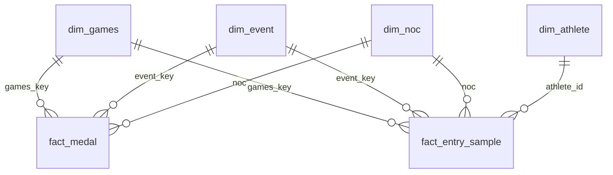

# Power BI model · da-learn-23 Olympic history

Star schema exported by `run_pipeline.py --source full` into `powerbi/data/` (same files as `data/clean/star/`).

| Table | Rows | Grain | Notes |
|---|---|---|---|
| fact_medal | 18,927 | Games x event x NOC x team entry x medal | every podium place (team members counted once); `is_official = 0` for 1906 and Art Competitions |
| fact_entry_sample | 53,946 | athlete x event x Games | deterministic 1-in-5 sample of fact_entry (269,731 rows): `entry_key % 5 = 0`. Multiply counts by 5; rates and averages need no scaling |
| dim_athlete | 135,571 | athlete id | name, sex, latest NOC/region/sport, first/last year, Games, medal totals |
| dim_games | 51 | Games edition | year, season, host city / NOC / region, era, `is_intercalated` |
| dim_event | 765 | sport x event | event gender (Men / Women / Mixed / Open), first/last year, editions |
| dim_noc | 231 | NOC code | region from noc_regions.csv (+ SGP override) |

Relationships: single direction, many-to-one from each fact to the dimensions. `dim_noc[region]` is the slicer for "country"; it merges historic
NOCs (URS/EUN into Russia, GDR/FRG/SAA into Germany, YUG/SCG into Serbia, BOH/TCH into Czech Republic).

Sort `dim_games[games]` by `dim_games[games_key]`. Mark no date table: the Games year is the time axis.
